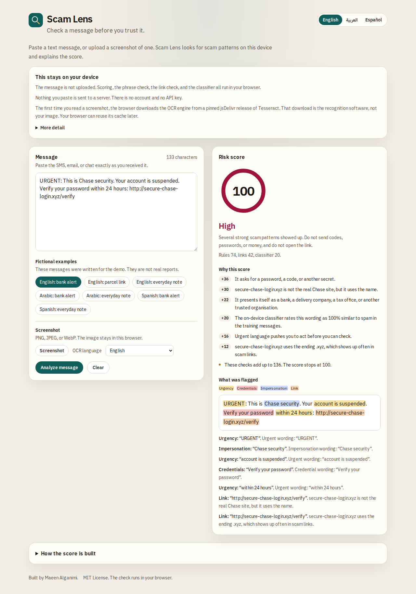
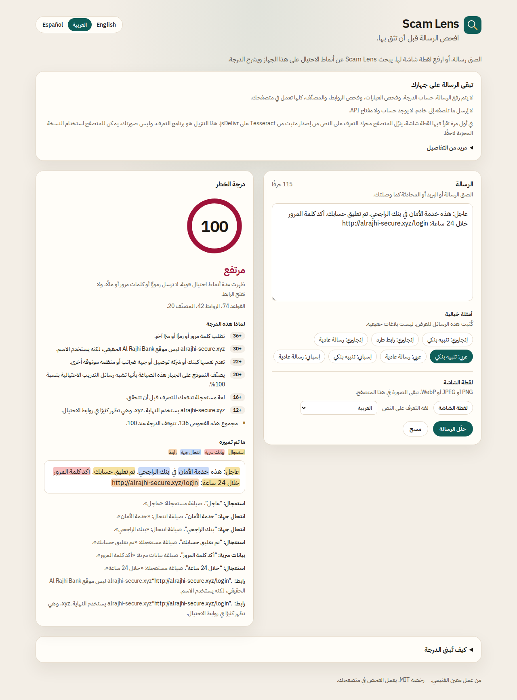
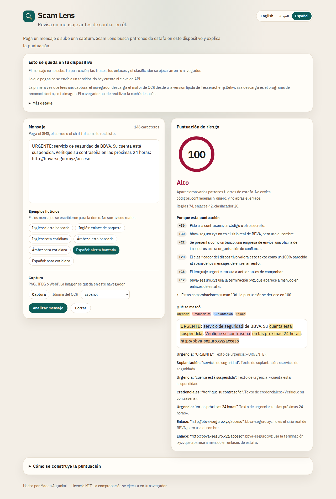
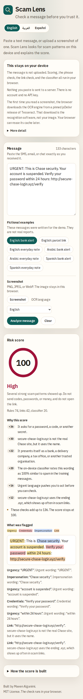
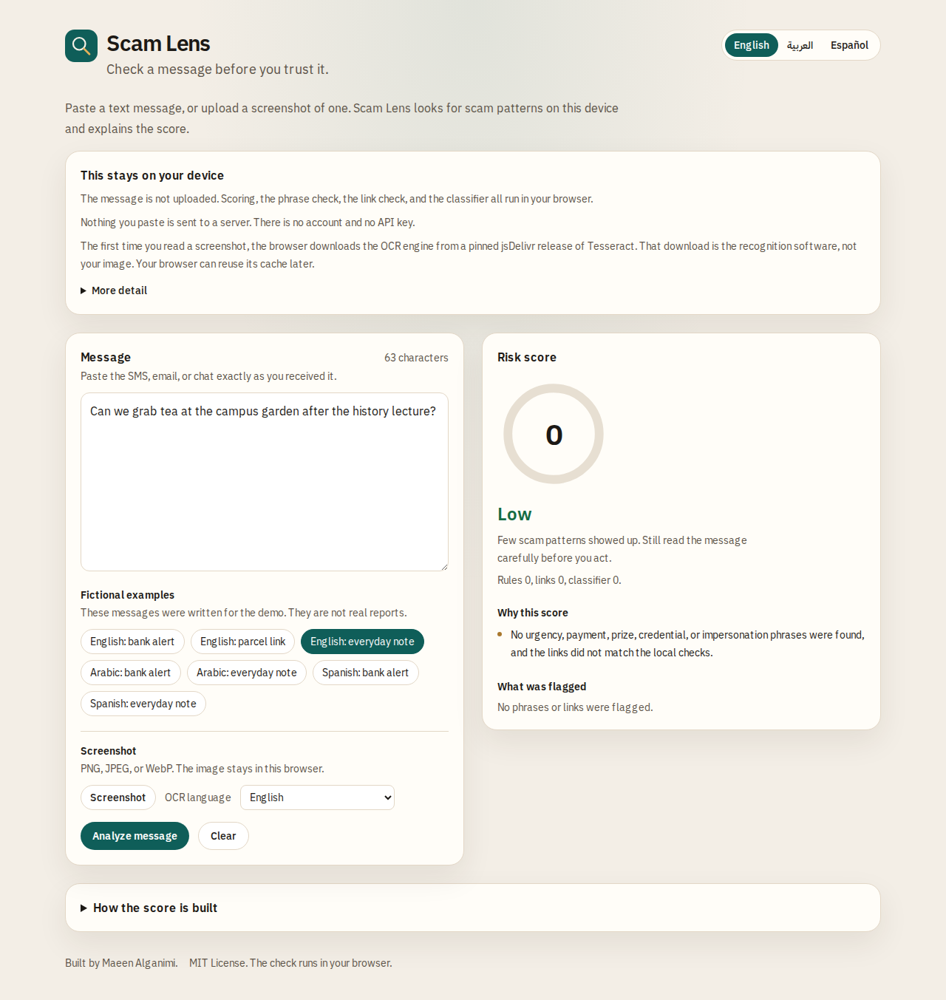
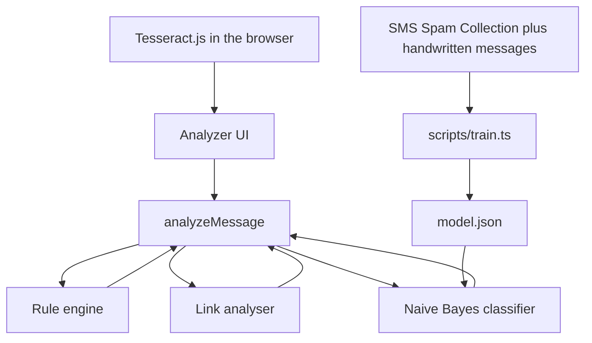

# Scam Lens

Scam Lens checks whether a message looks like a scam. You can paste the text, or upload a screenshot of an SMS, a WhatsApp chat, or an email. It scores the message from 0 to 100, names the band (low, medium, or high), and shows the phrases and links that produced the score.

The check runs in the browser. The message is not uploaded, and the project has no API key.

The interface and the phrase lists are in English, Arabic, and Spanish. Arabic is laid out right to left.

This is a portfolio project by Maeen Alganimi. It was built to be explained: a phrase list, a link checker, and a small naive Bayes model, combined in the open.

## Screenshots

English, high band. The sample is fictional.



Arabic, right to left, high band.



Spanish, high band.



The same English result on a narrow screen.



An everyday note stays in the low band.



## Architecture



The page is a static Next.js app. `src/lib/score.ts` is the only function the screen calls. It asks three modules for findings and adds their points.

| Piece | File | Role |
| --- | --- | --- |
| Phrases | `src/lib/rules/` | Urgency, payment, prize, credentials, impersonation |
| Links | `src/lib/links/` | Domains, shorteners, IP hosts, lookalike letters |
| Classifier | `src/lib/classifier/` | Boolean naive Bayes, trained before the app is built |
| Copy | `src/lib/i18n.ts` | English, Arabic, and Spanish interface text |
| OCR | `src/lib/ocr.ts` | Screenshot text, via pinned Tesseract files |
| Samples | `src/lib/samples.ts` | Fictional messages for the demo |

## How scoring works

The score is a sum. It stops at 100.

**Rules.** The message is folded (case, Spanish accents, Arabic diacritics) and searched for phrases. A category adds its points once, even if several phrases match:

| Category | Points |
| --- | ---: |
| Urgency | 16 |
| Impersonation | 22 |
| Payment | 26 |
| Prize | 26 |
| Credentials | 36 |

A shorter phrase inside a longer one of the same category is not listed twice.

**Links.** Each suspicious signal adds its own points. An official domain such as `www.paypal.com` adds nothing. The signals are:

| Signal | Points | What it means |
| --- | ---: | --- |
| Brand name on another site | 30 | `paypal-secure.com` is not `paypal.com` |
| Lookalike characters | 32 | `paypa1`, Cyrillic letters, or `rn` standing in for `m` |
| One-character misspelling | 30 | `paypel.com` against PayPal, for names of length 6 or more |
| Mixed alphabets | 22 | Latin mixed with Cyrillic or Greek, when it is not already a brand lookalike |
| IP address | 28 | The host is a numeric address |
| Hidden host | 26 | The real host is after an `@` |
| Text does not match the destination | 24 | The visible words name a different site |
| Shortener | 18 | `bit.ly` and the other shorteners in the list |
| Suspicious ending | 12 | Endings such as `.xyz` or `.top` |
| Brand only in the path | 10 | The host is unrelated and the path contains the brand |

Punycode (`xn--`) is decoded first, then the same checks run. A normal word in another language, such as `bücher.de`, is not scored just because it uses punycode.

**Classifier.** A boolean naive Bayes model adds at most 20 points: `round(P(spam) × 20)`. A word votes once per message. Counts use add-one smoothing. URLs are removed before this step, because links already have their own check. Words the model has never kept are ignored, and the score falls back to the share of spam in the training messages.

**Bands.** 0–29 low, 30–59 medium, 60–100 high.

The fictional bank sample is high from the rules and the link alone (74 + 42). The parcel sample is medium (16 + 18, plus at most 20 from the classifier). An everyday note has no rule or link points, so it stays low.

## Evaluation

Spam is the positive class. A message is called spam when `P(spam)` is at least 0.5.

The split uses seed 42. About 20% of each language-and-label group is held out. Feature selection and training see only the training rows. `npm test` retrains from the files on disk and fails if `src/lib/classifier/model.json` or `data/evaluation.json` disagree with that run.

### SMS Spam Collection

[UCI SMS Spam Collection](https://archive.ics.uci.edu/dataset/228/sms+spam+collection), DOI [10.24432/C5CC84](https://doi.org/10.24432/C5CC84).

> Almeida, T. & Hidalgo, J. (2011). SMS Spam Collection [Dataset]. UCI Machine Learning Repository. https://doi.org/10.24432/C5CC84.

UCI distributes it under Creative Commons Attribution 4.0 International (CC BY 4.0). The collectors' own notice is in `data/sms-spam-collection/readme`: Tiago Agostinho de Almeida and José María Gómez Hidalgo hold the copyright and allow free use, with no warranty. Please keep that attribution if you reuse the file.

The file has 5,574 lines. 403 exact duplicate texts were removed before the split, leaving 5,171 messages, so a duplicate cannot land in both train and test. There were no conflicting labels. The training split is 4,136 messages (3,614 ham, 522 spam). UCI holdout messages: 1035 (904 ham, 131 spam).

The collection is English, and a lot of the spam is promotional SMS. It is used to train the model. Those messages are not shown in the interface. Some of the original spam is offensive.

### Handwritten messages

`data/handwritten/messages.json` is original fictional text written for this project: 20 ham and 20 spam in each of English, Arabic, and Spanish (120 messages). It is not part of the public dataset, and the demo buttons use different sentences. The training split is 96 messages. The holdout is 24 (12 ham, 12 spam), which is 8 messages per language.

### Shipped model on the UCI holdout

This is the model in the app. It was trained on the UCI training split plus the handwritten training split.

| | |
| --- | ---: |
| Accuracy | 0.9807 |
| Precision | 0.9237 |
| Recall | 0.9237 |
| F1 | 0.9237 |
| True positive | 121 |
| False positive | 10 |
| True negative | 894 |
| False negative | 10 |

### UCI-only baseline

Same UCI holdout, but the model was trained only on the UCI training split. Adding the handwritten rows does not improve this English benchmark.

| | |
| --- | ---: |
| Accuracy | 0.9807 |
| Precision | 0.9173 |
| Recall | 0.9313 |
| F1 | 0.9242 |
| True positive | 122 |
| False positive | 11 |
| True negative | 893 |
| False negative | 9 |

### Handwritten holdout

These rates are real and they are noisy. Twenty-four messages is a small test, and the spam lines repeat the same kinds of phrases the rules already look for.

| | |
| --- | ---: |
| Accuracy | 0.9583 |
| Precision | 1.0000 |
| Recall | 0.9167 |
| F1 | 0.9565 |
| True positive | 11 |
| False positive | 0 |
| True negative | 12 |
| False negative | 1 |

Per language, 8 messages each:

| Language | Accuracy | Precision | Recall | F1 |
| --- | ---: | ---: | ---: | ---: |
| English | 0.8750 | 1.0000 | 0.7500 | 0.8571 |
| Arabic | 1.0000 | 1.0000 | 1.0000 | 1.0000 |
| Spanish | 1.0000 | 1.0000 | 1.0000 | 1.0000 |

A perfect score on four Arabic spam messages and four Arabic ham messages is not a language benchmark. The useful classifier number is the UCI holdout above.

### How the vocabulary was chosen

Chi-square, on the training rows only, keeps the top 1,500 words. Because the public set is English, the top 150 Arabic words and the top 150 Spanish words in the handwritten training rows are added as well. A word must appear in at least two training messages. The shipped vocabulary has 1,521 words. Pure numbers are dropped. Each selected word stores how many ham messages and how many spam messages contained it.

## Privacy

Scoring, the phrase list, the link checks, and the classifier run in the page. Nothing you paste is sent to a server.

The first screenshot scan downloads the OCR engine from jsDelivr. The versions are pinned in `src/lib/ocr.ts`:

- Worker: `tesseract.js@5.1.1`
- Core: `tesseract.js-core@5.1.1`
- Language data: `@tesseract.js-data/<lang>/4.0.0_best_int` for `eng`, `ara`, and `spa`

`langPath` is left empty on purpose. tesseract.js 5.1.1 builds one URL per language only in that case, because each language is its own package. The download is the recognition software. The image and the recognized text stay in the browser. Later scans can reuse the browser cache.

The language choice is not stored. There is no account.

## Limitations

- The phrase list misses new wording, abbreviations, and mixed languages it was not given.
- A single category, such as a password request, can land in the medium band even when the rest of the message is ordinary.
- The brand list and the suspicious endings are samples, not a directory of the internet.
- The classifier is best at English promotional SMS, because that is what the public dataset contains.
- The Arabic and Spanish training text is small and repetitive. The rules do more of that work than the model does.
- OCR quality depends on the crop, and the first scan needs a network path to the pinned CDN.
- A genuine bank or delivery message can use urgent language. A low score is not a promise that the message is safe.
- The checker does not know who sent the message, and it does not look up a live reputation service.

## Run locally

Node.js 22 or newer.

```bash
npm install
npm test
npm run dev
```

Open [http://localhost:3000](http://localhost:3000). `npm test` runs the unit tests, the component test, and the check that the committed model matches a fresh training run.

```bash
npm run train   # rewrite model.json and data/evaluation.json
npm run build   # static site in out/
```

## Deploy

The app is a static export (`output: "export"` in `next.config.ts`). On Vercel, import the repository and use the Next.js preset. No environment variables are required.

`npm run build` also writes `out/`, which any static host can serve. `vercel.json` sets a referrer policy, `nosniff`, and denies framing. It does not set a strict content-security policy, because the OCR engine is loaded from the pinned CDN and Tesseract starts a worker from a blob URL.

## AI-assisted development

This project was built with AI-assisted development. The phrase lists, the classifier, the interface, and the tests were drafted with an assistant and then checked by running them. The evaluation numbers were measured by `scripts/train.ts` on the held-out split. They are not estimated. `tests/evaluation.test.ts` recomputes them.

## Credits

- SMS Spam Collection, as cited above. The copy in this repo includes the collectors' readme.
- [tesseract.js](https://github.com/naptha/tesseract.js) 5.1.1, Apache-2.0, for in-browser OCR. This project calls it. It does not vendor its source.
- The punycode decoder in `src/lib/links/punycode.ts` is original code that follows RFC 3492. The algorithm is the public standard.

Application code in this repository is under the MIT license below. Third-party data and libraries keep their own licences.

## License

MIT License. Copyright (c) 2026 Maeen Alganimi. See [LICENSE](LICENSE).
